# Human skin ITS2 시험 분석 결과 보고서

> 분석 상태: 전처리·분류법의 기술적 비교 완료; 오염원 및 생물학적 차이의 최종 검증 진행 중. 별도 표시가 없는 수치는 저장소의 QC20 분석 기준.

## 목차

1. [데이터셋](#1-데이터셋)
2. [실험 및 분석 방법](#2-실험-및-분석-방법)
3. [결과](#3-결과)
   - [3.1 Cutadapt와 ITSxpress: paired-end](#31-cutadapt와-itsxpress의-paired-end-결과)
   - [3.2 maxEE 2/2와 8/8](#32-maxee-22와-88의-비교)
   - [3.3 Paired-end와 single-end](#33-paired-end와-single-end의-비교)
   - [3.4 시험용 single과 complete forward-only](#34-시험용-single과-complete-forward-only의-비교)
   - [3.5 Complete forward-only에서 Cutadapt와 ITSxpress](#35-complete-forward-only에서-cutadapt와-itsxpress의-비교)
   - [3.6 Complete forward-only에서 ITSx와 ITSxpress](#36-complete-forward-only에서-itsx와-itsxpress의-비교)
   - [3.7 *Aureobasidium* 상세 결과](#37-aureobasidium-상세-결과)
4. [현재 결론과 남은 검증](#4-현재-결론과-남은-검증)
5. [참고문헌과 분석 파일](#5-참고문헌과-분석-파일)

## 1. 데이터셋

- 대상: 사람 피부 ITS2 amplicon 시험 데이터. 전처리 방법, 음성대조군 신호, PCR 조건 및 taxonomy 안정성 점검.
- 비교 단위: 동일한 **83개 library**를 Cutadapt/ITSxpress × paired/single 네 조합으로 재처리함. 83은 독립적인 생물학적 표본 수가 아닌 분석 library 수.

| 구분 | 내용 | 해석 단위 |
| --- | --- | --- |
| True sample | 사람 피부 swab; 대상자와 피부 부위를 구분 | 같은 biological sample의 PCR 조건 반복을 고려 |
| Negative control | Air swab, clean-bench swab, empty-tube control | control source별 read와 ASV identity를 따로 확인 |
| Mock | Mock community | 전처리와 분류 결과를 점검하는 보조 자료 |

- 연구 질문: 피부 진균 ITS2의 안정적 회수 여부; True와 control의 군집·다양성 차이; PCR 조건·DNA 농도의 영향; Cutadapt·ITSxpress·ITSx·분류 DB에 따른 결과 변화.
- 현재 범위: **전처리와 taxonomy에 따른 기술적 차이** 중심. Negative control의 높은 read 수만으로 오염원이나 실험 실패를 확정할 수 없음.

## 2. 실험 및 분석 방법

### 2.1 PCR 조건과 시료 구조

- PCR 조건: 1차 PCR **33/35 cycle** × 2차 PCR **8/10 cycle**의 네 조합(`33+8`, `33+10`, `35+8`, `35+10`).
- 반복 구조: 같은 피부 시료의 여러 PCR 조건이 포함됨. 조건 간 결과를 독립 표본으로 취급하지 않음.
- 추적 변수: Qubit DNA 농도, 대상자, 피부 부위, control type.
- Wet-lab 정보: 저장소에서 확인된 조건만 기재함. 프라이머 서열·장비·추출 protocol 등은 추가 확인 필요.

### 2.2 전처리와 분류 비교

| 비교 축 | 조건 | 이 보고서에서 구분하는 의미 |
| --- | --- | --- |
| Trimming/ITS 추출 | Cutadapt primer trimming, ITSxpress ITS2 extraction, ITSx post-ASV extraction | ITSx는 이미 생성된 Cutadapt ASV에 적용하므로 ITSxpress의 raw-read 전처리 통과율과 직접 같지 않음 |
| Read mode | Paired-end, 시험용 single-end, complete forward-only | complete forward-only는 forward read만 사용해 처음부터 완료한 별도 workflow |
| DADA2 filtering | paired `maxEE 2/2`·`8/8`; forward-only `maxEE 2` | maxEE 비교에서는 ITSxpress paired와 QC20을 고정 |
| Taxonomy | UNITE v10 99% fungi-only, UNITE v10 dynamic all-eukaryotes | 비교 DB는 분류 대상 범위와 clustering 방법이 함께 다름 |

- 평가 항목: read retention, 최종 ASV 수, ASV 길이, taxonomic label, 상대풍부도 및 raw read count.
- Beta diversity: Aitchison distance 및 PCoA 중심 평가.
- Taxonomic composition: raw count 또는 total-sum-scaled 상대풍부도 사용. Rarefied table은 조성 분석에 사용하지 않음.
- Rarefaction curve: library depth 점검에 사용. 임의의 cutoff를 적용한 사전 sample 제거는 수행하지 않음.
- 주요 ASV 종명: classifier label과 서열·BLAST 근거를 함께 대조함.

## 3. 결과

### 3.1 Cutadapt와 ITSxpress의 paired-end 결과

- 초기 가설: ITSxpress가 rRNA flank를 제거하고 ITS2 core를 제공해 종 수준 분류를 개선할 가능성.
- 서열 관계: 일부 짧은 ITSxpress ASV가 긴 Cutadapt ASV 내부에 정확히 포함됨(**exact containment**).
- 주요 관찰: *Aureobasidium*-like sequence family가 Cutadapt paired에서 회수되었으나 ITSxpress paired에서 주로 소실됨.
- 해석: 다른 read mode에서 같은 family가 확인됨. ITSxpress paired의 미검출을 생물학적 부재로 해석할 수 없음.

- 추가 관찰: `Fungi_k` 또는 `Ascomycota_p`로만 분류된 Cutadapt ASV와 ITSxpress ASV에서 동일한 내부 서열 확인.
- 미해결: Cutadapt에만 남은 구간의 정체(5.8S/28S flank, primer 잔존, 비표적 amplicon 등)는 서열 구조만으로 확정 불가. [paired 전처리 분석](01_Preprocessing.Rmd) 및 [ASV 정렬](01c_Fungi_k_Ascomycota_p_sequence_alignment.Rmd) 참조.

### 3.2 maxEE 2/2와 8/8의 비교

- 비교 조건: QC20·ITSxpress paired-end 고정; DADA2 `maxEE 2/2` 대 `8/8`.
- 관찰: 전체 군집 배치와 주요 species profile이 거의 동일함. `8/8` 전용 ASV는 대부분 극저빈도·단일 sample ASV이며 새로운 주요 species 신호를 형성하지 않음.
- 해석: 본 데이터의 큰 Cutadapt–ITSxpress 차이를 `maxEE` 설정만으로 설명하기 어려움. 다른 ITS2 데이터로 일반화하기는 어려움. [전체 분석](01_ITSxpress_maxEE22_vs_maxEE88.Rmd) 참조.

- 문헌 비교: Nayman 등(2023)의 **세균 16S V4 mock community** 분석. 엄격한 filtering에서 read 손실 증가; DADA2 계열의 `maxEE` 1→3 완화에서 read retention이 약 80.5%까지 증가함([원문 Fig. 5a](https://doi.org/10.1099/jmm.0.001756)).
- 그림 해석: 문헌의 read-retention 경향과 본 ITS2의 주요 군집·종 신호 안정성을 **재도식화**함. 대상·`maxEE` 범위·평가 지표가 달라 직접적인 반박 관계로 해석할 수 없음.

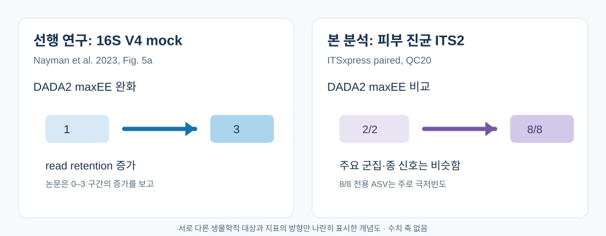

*그림 1. 좌측: Nayman 등(2023) Fig. 5a의 DADA2 read-retention 증가 경향 재도식화. 우측: 본 ITSxpress paired 분석의 `2/2` 대 `8/8`에서 주요 군집·종 신호 변화가 작음. 서로 다른 지표의 수치 비교가 아닌 방향 비교.*

### 3.3 Paired-end와 single-end의 비교

- 설계: 동일 **83개 library**의 Cutadapt paired/single × ITSxpress paired/single 네 pipeline 비교.
- Read·ASV: 두 trimming 방법 모두 single-end에서 read 보존량이 더 많음. Cutadapt single의 ASV 수가 가장 많음.
- 군집: 전체 sample 배치는 대체로 유지되나 trimming과 read mode에 따른 소규모 조성 변화 확인.
- *Aureobasidium*-like family: Cutadapt paired·single과 ITSxpress single에서 회수; ITSxpress paired에서 주로 소실. ITSxpress 후 한 mate가 짧아져 paired DADA2 처리에서 탈락할 가능성과 일치함.
- 분석 단위: 동일 library의 기술적 재처리 결과이며 독립 표본이 아님. [네 pipeline 비교 및 BLAST 보고서](01d_single_paired_BLAST_comparison.Rmd) 참조.

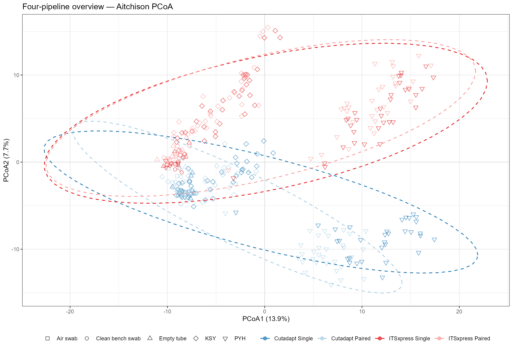

*그림 3.3-1. 동일 83개 library를 Cutadapt/ITSxpress × single/paired로 처리한 Aitchison PCoA. 색은 pipeline, shape은 control source 또는 대상자를 나타냄. 네 pipeline에서 큰 sample 배치 구조는 유지되지만 trimming과 read mode에 따른 이동이 함께 관찰됨.*

| Cutadapt Single | Cutadapt Paired |
| --- | --- |
| 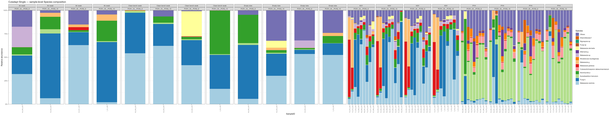 | 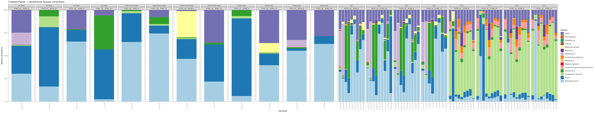 |

| ITSxpress Single | ITSxpress Paired |
| --- | --- |
| 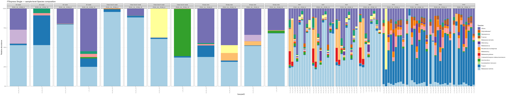 | 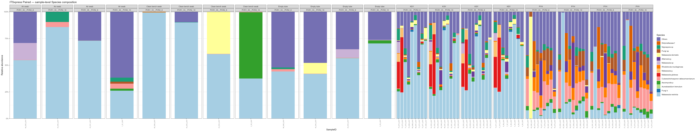 |

*그림 3.3-2. 네 pipeline의 sample별 species-level relative composition. 같은 색은 같은 taxon이며, ITSxpress paired에서 우점 sequence family가 소실되는 현상을 PCoA와 함께 확인할 수 있음.*

### 3.4 시험용 single과 complete forward-only의 비교

- 비교: **시험용 Cutadapt single** 대 **complete forward-only Cutadapt**. Sample별 read depth, 최종 ASV 수, exact-ASV 공유율 및 taxonomy 해상도 점검.
- Complete forward-only: forward read만 입력해 전체 workflow 재처리; single-end `maxEE 2` 사용. 이전 파일명 `ee22`는 paired workflow 표기에서 유래함.
- 해석 범위: 시험용 결과와 complete workflow의 일치도를 확인하는 QC. 생물학적 다양성의 집단 간 검정 결과가 아님. [complete single-end QC 보고서](01e_complete_single_end_preprocessing.Rmd) 참조.

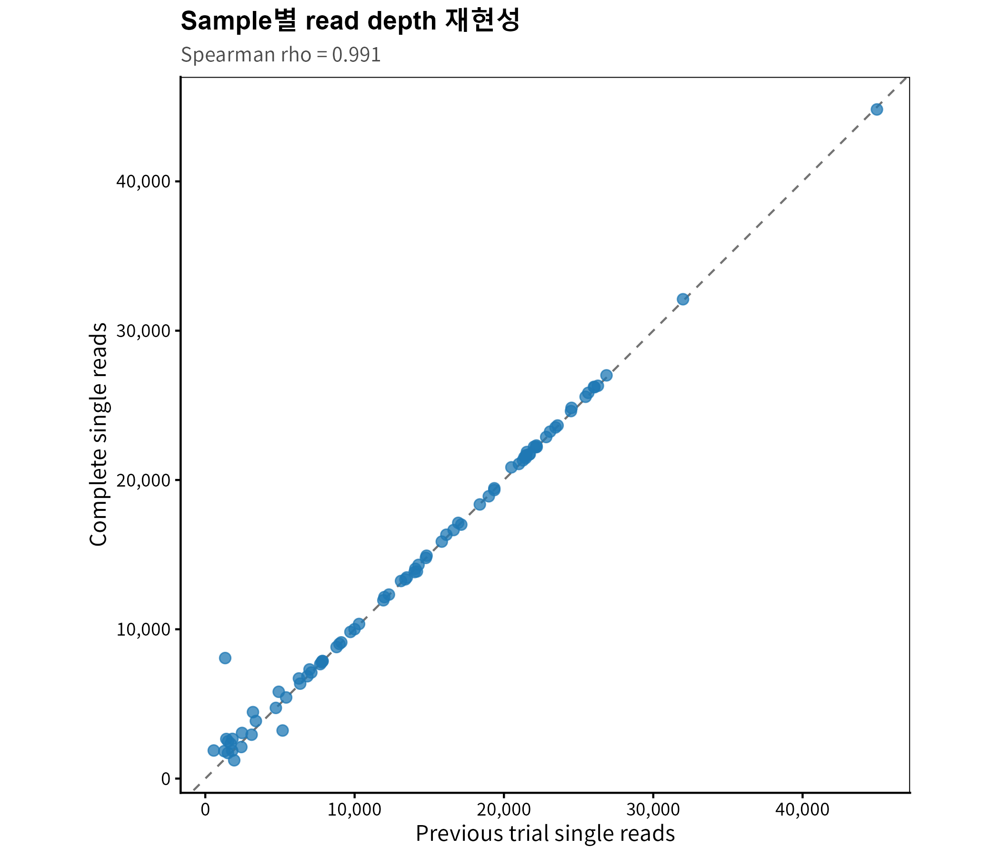

*그림 3.4-1. 시험용 Cutadapt single과 complete forward-only의 sample별 read depth 비교. Spearman rho=0.991로 library 간 깊이 순서는 강하게 재현되지만, exact ASV 및 총 read 수가 완전히 동일하다는 의미는 아님.*

### 3.5 Complete forward-only에서 Cutadapt와 ITSxpress의 비교

- 비교: 동일 83개 sample의 complete forward-only 처리.
- 보존량: Cutadapt 약 **1,186,913 reads·1,855 ASV**; ITSxpress 약 **115,907 reads·211 ASV**. Sample별 ITSxpress/Cutadapt read-depth 비율 중앙값 약 **6%**.
- Taxon 변화: 식물 유래 ASV뿐 아니라 *Malassezia restricta*, *M. globosa*, *Aureobasidium* 계열 신호도 ITSxpress에서 크게 감소함.
- 해석: ITSxpress 통과 여부만으로 진균 여부를 판정할 수 없음. Cutadapt의 높은 read·ASV 수를 생물학적 다양성 증가로 해석할 수 없음. [complete forward 비교](01f_complete_forward_Cutadapt_vs_ITSxpress.Rmd) 참조.

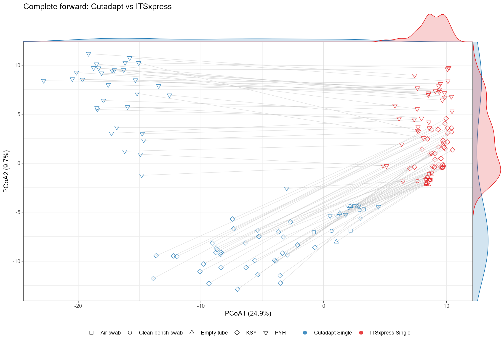

*그림 3.5-1. 동일 SampleID를 연결한 complete-forward Cutadapt–ITSxpress Aitchison PCoA. 방법 간 이동이 커서 ITSxpress의 read 손실이 단순한 depth 감소가 아니라 조성 변화로 이어짐을 보여줌.*

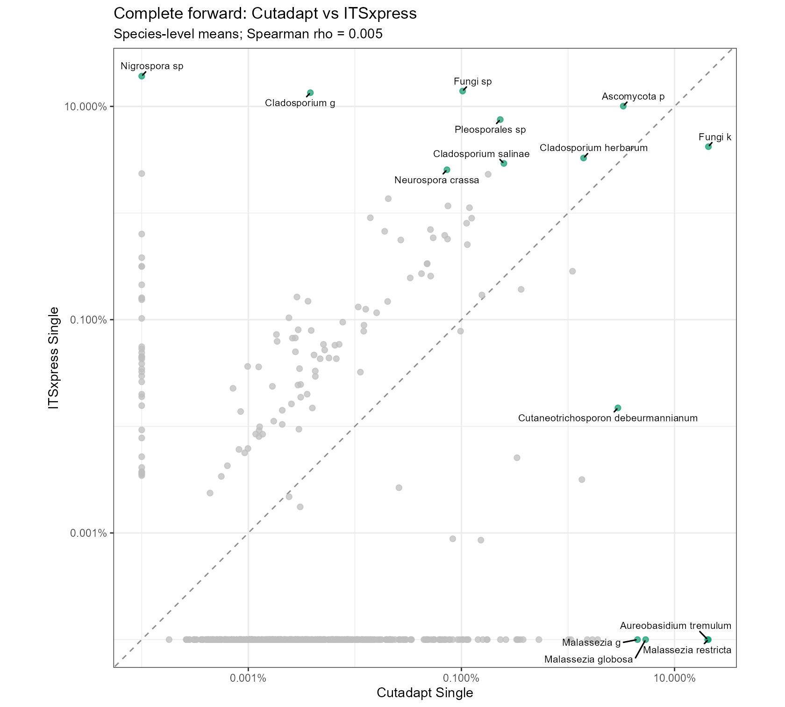

*그림 3.5-2. 각 점은 83개 sample에서 평균한 species fallback taxon. 대각선 아래쪽일수록 Cutadapt 대비 ITSxpress에서 감소한 taxon이며, `Malassezia g`, `M. globosa`, `M. restricta`와 `Aureobasidium tremulum` label이 ITSxpress에서 거의 0에 가까워짐.*

| Cutadapt complete-forward | ITSxpress complete-forward |
| --- | --- |
| 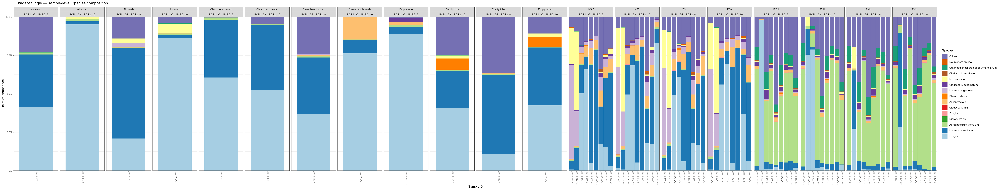 | 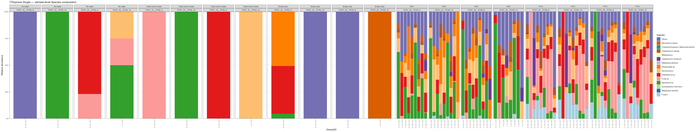 |

*그림 3.5-3. 동일한 taxon 색을 사용한 sample별 species relative composition. Cutadapt에서 KSY·PYH 피부 sample의 큰 비중을 차지하던 Malassezia 계열 색이 ITSxpress 결과에서 크게 축소되거나 다른 상위 taxon 조성으로 대체됨.*

- 분류 DB 비교: 두 처리 방법에 fungi-only DB와 all-eukaryote DB를 각각 적용함. All-eukaryote DB에서 Cutadapt의 비진균 off-target 탐지 가능. ITSxpress 단계에서 소실된 read의 복구는 불가.

- 그림 출처: [01g 렌더된 HTML](01g_single_UNITE_database_comparison.html)에 내장된 분석 그림을 개별 파일로 추출함.
- DB 변경의 의미: 같은 ASV count의 kingdom·rank·taxon label 변화. Raw-read 전처리 단계의 read 제거와 구분 필요.

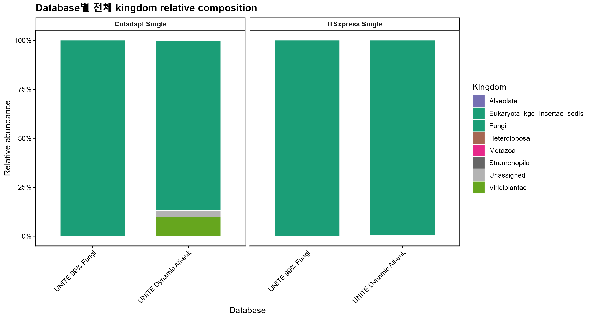

*그림 2. All-euk DB의 kingdom별 상대풍부도. ASV fraction과 read fraction을 함께 평가함.*

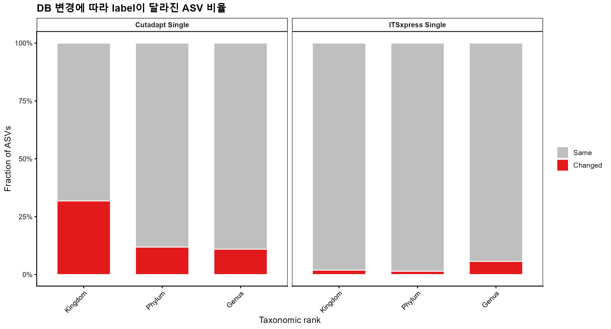

*그림 3. DB 변경에 따른 kingdom·phylum·genus label 변화 ASV 비율. 분류 해상도의 우열 지표로 직접 사용 불가.*

| | UNITE 99% fungi-only | UNITE dynamic all-eukaryotes |
| --- | --- | --- |
| Cutadapt complete-forward | 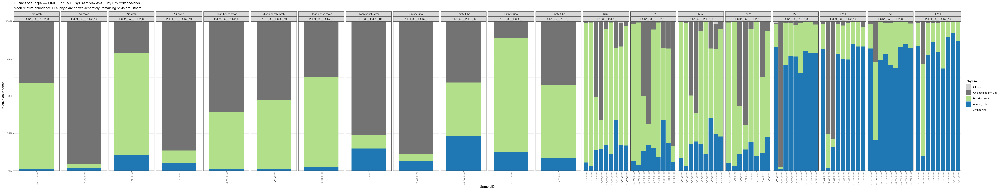 | 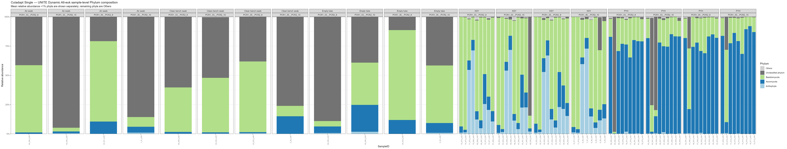 |
| ITSxpress complete-forward | 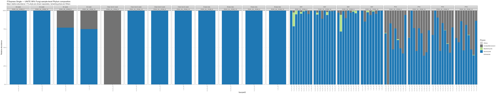 |  |

*그림 4. 방법 × DB별 phylum 조성. Fungi-only와 all-euk DB는 reference 범위와 clustering scheme이 동시에 다름.*

| Cutadapt: DB 전후 species-level PCoA | ITSxpress: DB 전후 species-level PCoA |
| --- | --- |
| 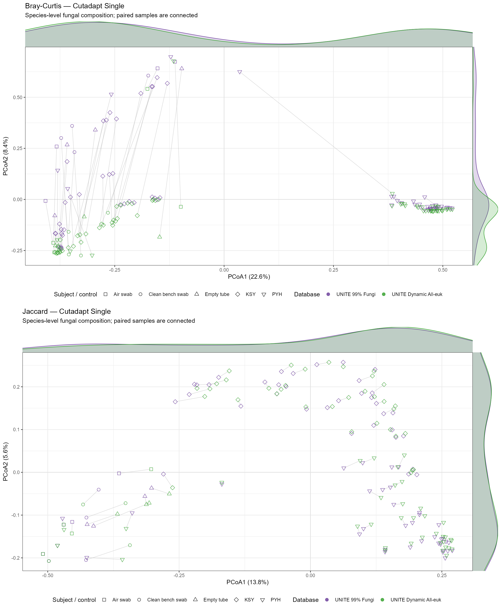 | 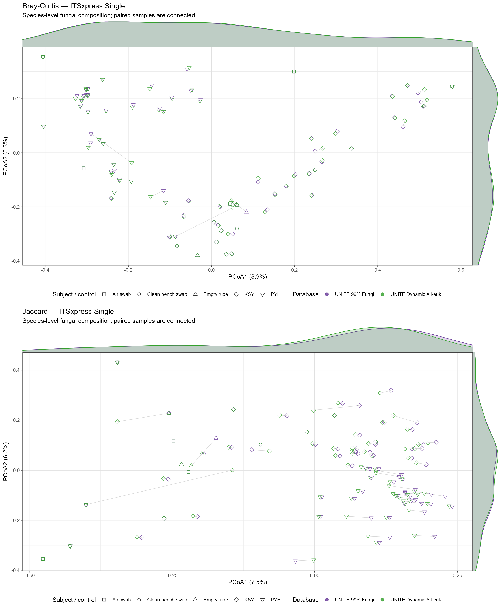 |

*그림 5. 같은 SampleID를 연결한 DB별 Bray–Curtis·Jaccard PCoA. Species label 변경에 따른 이동을 database sensitivity로 해석함.*

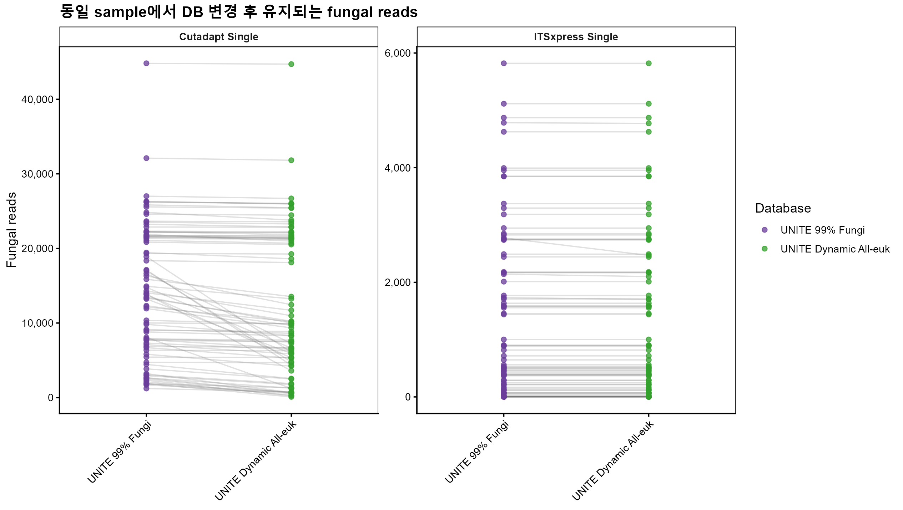

*그림 6. DB 변경에 따른 sample별 fungal read 분류 변화. 동일 ASV의 kingdom 재분류 결과이며 전처리 단계에서 소실된 read의 복구량이 아님.*

| Cutadapt의 감소 상위 sample | ITSxpress의 감소 상위 sample |
| --- | --- |
| 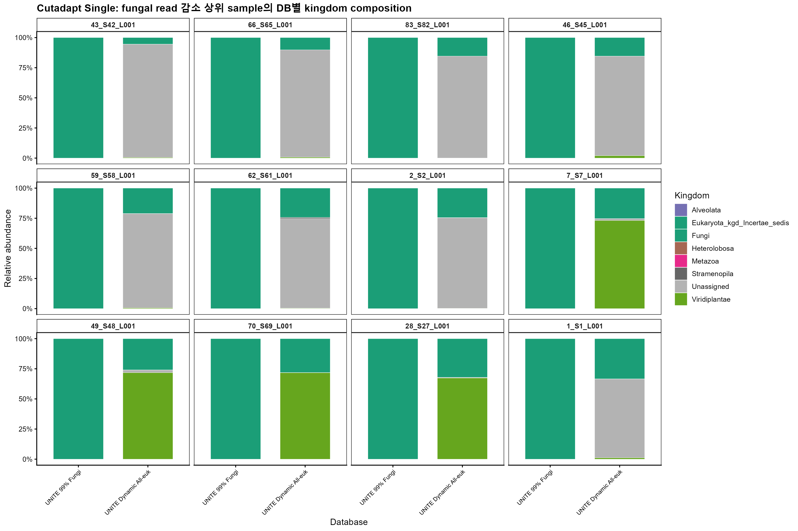 | 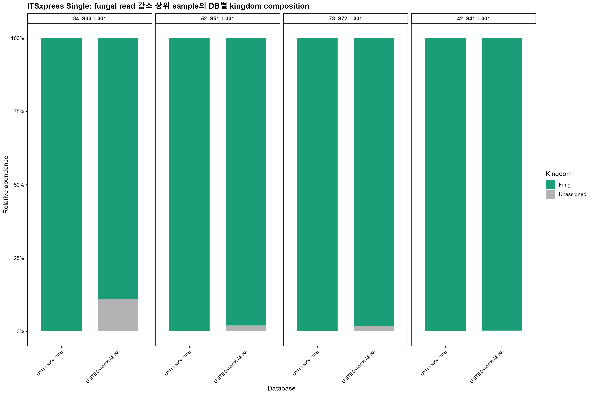 |

*그림 7. Fungal fraction 감소 상위 sample의 DB별 kingdom 조성. 두 방법의 ASV pool과 read depth가 서로 다름.*

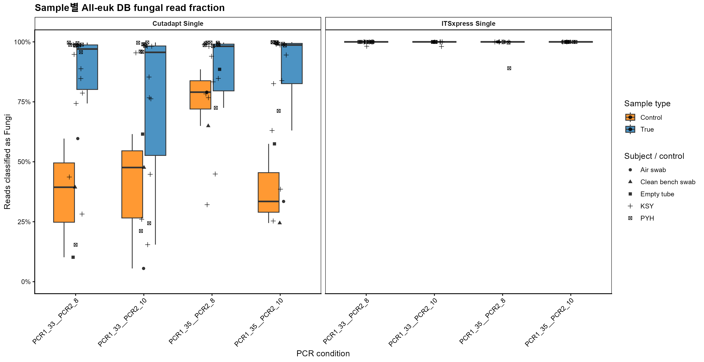

*그림 8. PCR 조건·sample type별 fungal fraction. DB 전후 차이는 read의 kingdom 재분류에 해당함.*

### 3.6 Complete forward-only에서 ITSx와 ITSxpress의 비교

- ITSx 1.1.3 적용 대상: **Cutadapt–DADA2로 이미 생성된 1,855개 ASV**. ITS2 경계와 추출 서열 감사.
- 기본 설정 대 `--partial 50`: ASV ID·추출 서열·taxonomy를 대조함. 이번 실행에서 추가 회수 또는 재분류 효과 없음.
- Count 정의: ITSx의 ‘회수 read’는 추출된 ASV에 연결된 **기존 count**. DADA2 이전 raw FASTQ를 처리하는 ITSxpress의 통과 read 수와 동일 단계의 생존율로 비교할 수 없음.

- 경계 판정: ITSx 출력 FASTA의 서열 존재만으로 완전한 LSU 경계 검출을 보장할 수 없음.
- 추가 확인: ASV별 경계 상태와 제거 구간을 점검하고 reference alignment·BLAST로 구간의 성격 확인 필요. [ITSx ASV audit](01g_single_UNITE_database_comparison.Rmd) 참조.

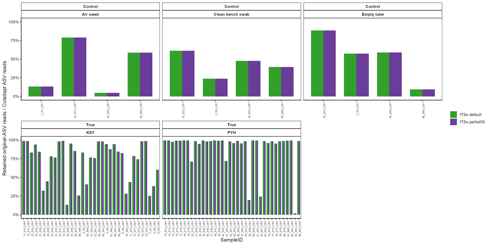

*그림 9. Cutadapt–DADA2 ASV에 ITSx를 사후 적용한 뒤의 ASV 및 기존 count 연결 회수율.*

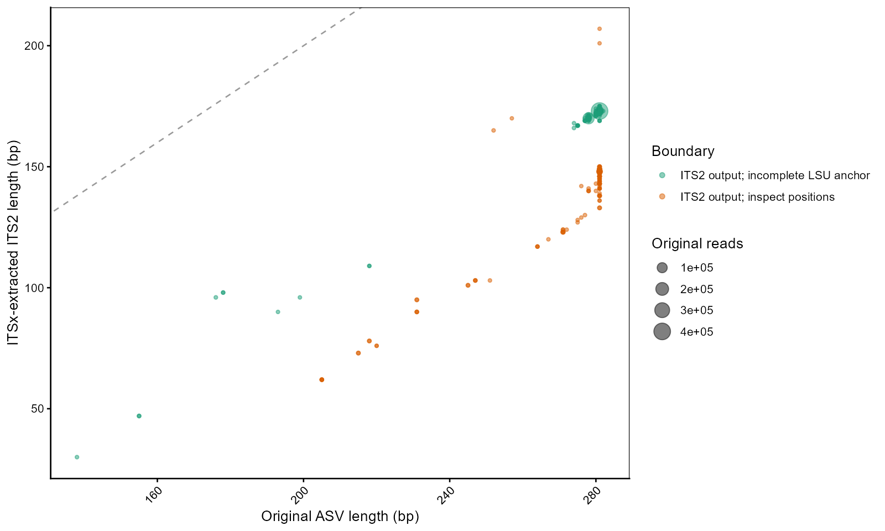

*그림 10. ITSx 추출 전후 길이·경계 상태. ITS2 출력만으로 LSU anchor 완전성 판정 불가.*

| UNITE 99% fungi-only에서 ITSx 전후 | UNITE dynamic all-euk에서 ITSx 전후 |
| --- | --- |
| 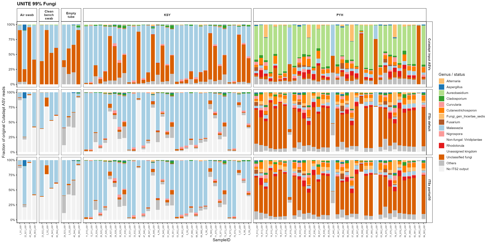 | 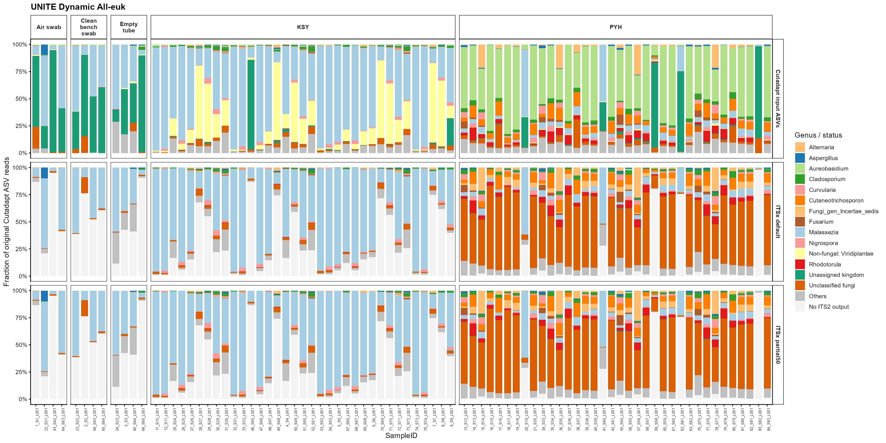 |

*그림 11. 원래 Cutadapt·ITSx 기본·partial50의 sample별 genus 조성. 분모는 원래 Cutadapt read 수로 고정; 미추출 부분은 `No ITS2 output`으로 표시함.*

### 3.7 *Aureobasidium* 상세 결과

#### 3.7.1 전처리 방법과 DB별 검출·조성
- 초기 네 pipeline: 우점 *Aureobasidium*-like family가 Cutadapt single·paired와 ITSxpress single에서 비슷한 규모로 회수됨; ITSxpress paired에서 주로 소실됨.
- Complete forward-only: ITSxpress에서 해당 신호가 다시 크게 감소함. Single-end 사용만으로 안정적인 회수가 보장되지는 않음.
- 생물학적 해석: 특정 대상자의 피부 시료에서 높은 풍부도와 DNA 농도의 양의 관계가 탐색적으로 관찰됨. Biomass·PCR 증폭·전처리 편향의 기여는 미확정.

- DB별 label: fungi-only와 all-eukaryote DB가 같은 ASV에 서로 다른 rank·이름을 부여할 수 있음.
- *Aureobasidium* 후보: all-euk DB에서도 Fungi로 유지되는 신호 존재. Broad reference 적용만으로 제외할 근거 없음. Species label의 confidence만으로 종 동정 불가. [DB 비교 보고서](01g_single_UNITE_database_comparison.Rmd) 참조.

- 그림 범위: 방법 × DB별 **전체 fungal genus 조성**. *Aureobasidium*의 변화는 전체 조성 속에서 해석하며, 서로 다른 ASV pool의 1:1 대응으로 취급하지 않음.

| | UNITE 99% fungi-only | UNITE dynamic all-eukaryotes |
| --- | --- | --- |
| Cutadapt complete-forward | 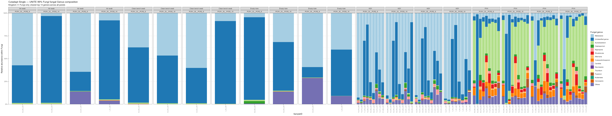 | 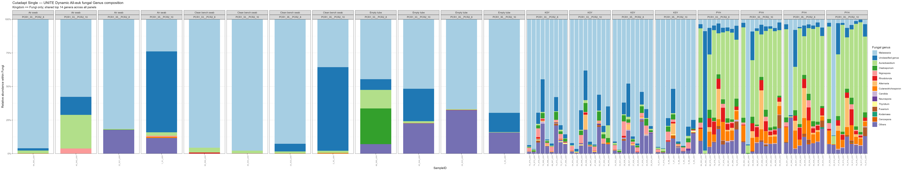 |
| ITSxpress complete-forward |  | 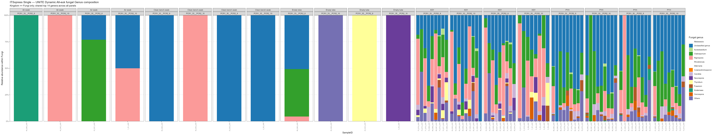 |

*그림 12. 방법·DB별 전체 fungal genus 조성. [원본 HTML](01g_single_UNITE_database_comparison.html)의 네 패널. DB 범위와 clustering scheme이 동시에 달라 분류명 변경의 원인을 단일 요인으로 분리할 수 없음.*

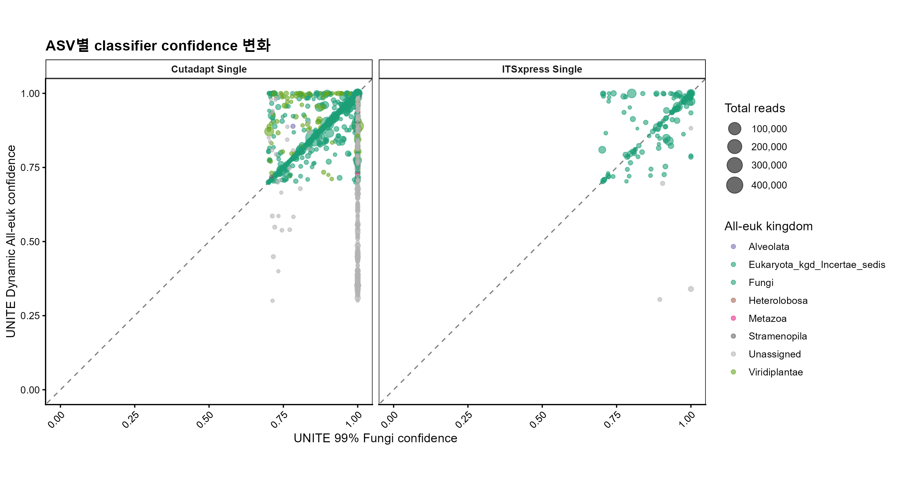

*그림 13. 전체 ASV의 DB별 classifier confidence. 서로 다른 rank의 confidence를 종 동정 정확도로 직접 비교할 수 없음.*

#### 3.7.2 BLAST 및 서열 정렬

- BLAST 대상: 대표 Cutadapt full ASV **303 bp**와 같은 read pattern의 ITSxpress core **155 bp**. 두 서열 모두 *Aureobasidium* 속을 지지함.
- 종 수준: *A. pullulans*와 *A. melanogenum*이 각각 query coverage **100%**, identity **100%**로 동률. Classifier의 `A. tremulum` 종명 확정 불가.
- 권장 표기: **Aureobasidium-like ASV**, *Aureobasidium* spp., *Aureobasidium*-associated sequence family. [BLAST 요약표](Results/01_Preprocessing/Aureobasidium_tremulum_BLAST_summary.csv) 참조.

- ITSx 추출 후 **남은 구간**은 원서열과 100% 일치함. 분류 변화는 남은 염기의 오류보다 입력 구간 변화와 부합함.
- 100% identity의 범위: 남은 구간에 한정됨. 제거된 flank의 정체와 종 동정은 별도 검증 필요.

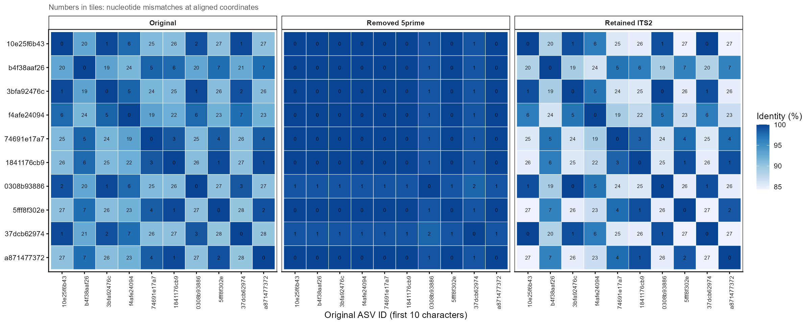

*그림 14. 후보 ASV의 원서열·제거된 5′ 구간·남은 ITS2 구간 비교. [원본 HTML](01g_single_UNITE_database_comparison.html)에서 추출함. Reference 기반 종 동정 또는 계통수 분석은 아님.*

#### 3.7.3 QIIME Naive Bayes와 BLAST 근거의 대조

- 비교 자료: complete-forward Cutadapt **1,855 ASV**, ITSxpress **211 ASV**의 batch BLAST와 QIIME Naive Bayes(NB) classifier 결과.
- 후보 구성: Cutadapt *Aureobasidium* 후보 10개, ITSxpress 후보 9개. **서로 다른 ASV pool**이며 1:1 대응 불가.
- 그림 축: BLAST `percent identity × query coverage / 100`; QIIME 최종 분류 confidence. 서로 다른 rank의 confidence를 종 동정 정확도로 직접 비교할 수 없음. BLAST 값이 없는 점이 반드시 no-hit을 뜻하지는 않음.

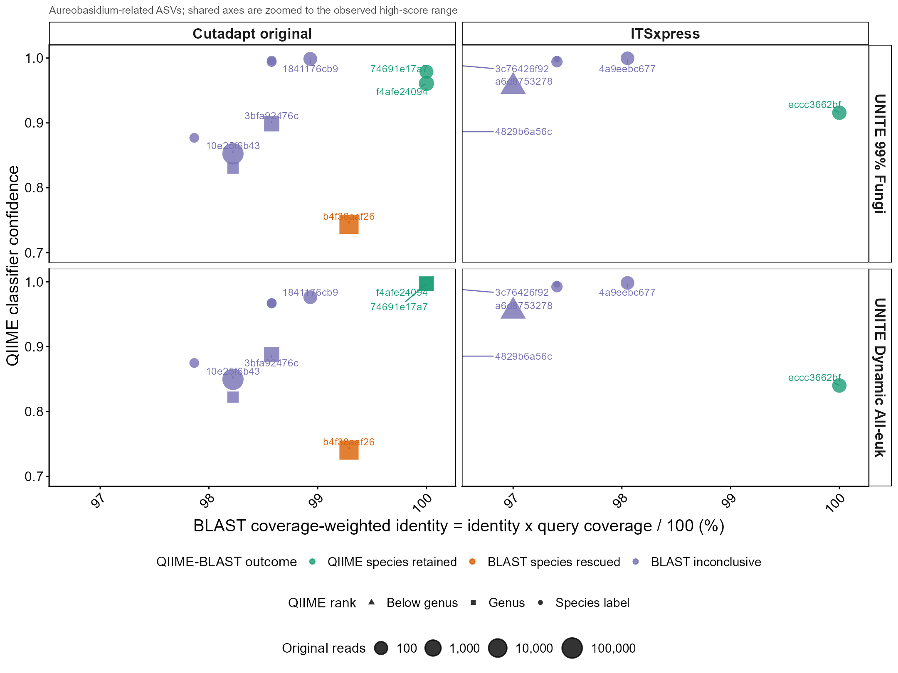

*그림 15. 후보 ASV의 QIIME 최종 분류 confidence와 BLAST coverage-weighted identity. [원본 HTML](01g_single_UNITE_database_comparison.html)에서 추출함. 상충하는 label은 ASV별 coverage·identity·동률 top hit에 따라 보수적으로 표기함.*

## 4. 현재 결론과 남은 검증

- 전처리 방법과 read mode에 따라 read retention, ASV 수 및 taxonomic label이 크게 달라짐. 본 데이터의 `maxEE 2/2` 대 `8/8` 차이는 상대적으로 작음.
- 잠정 주 분석 경로: **Cutadapt primer-trimmed complete forward-only → DADA2**. ITSxpress single/paired 결과는 방법 민감도 확인에 사용.
- 비진균 off-target: KSY의 고풍부 `Fungi_k` ASV `5c8f111a2f4a8e9e41a1cb58ebc985f6`가 BLAST에서 **281/281 bp, 100% identity**로 *Raphanus sativus*를 지지함. All-euk DB의 분류도 일치함. KSY의 모든 `Fungi_k`에 적용되는 결론은 아님.
- All-euk DB의 non-fungal·unassigned ASV: 우선 감사 목록으로 사용. 기존 fungi-only 99% DB와 dynamic all-euk DB는 **scope와 clustering이 동시에 다름**. 순수 scope 효과 확인을 위해 clustering을 맞춘 추가 비교 필요.
- 남은 검증: control source별 반복 ASV, 농도·PCR 조건을 이용한 오염 분석, 주요 ASV batch BLAST, fungal filtering 전후 alpha/beta diversity 비교. 오염원 및 생물학적 차이의 최종 판정은 보류.

## 5. 참고문헌과 분석 파일

- Nayman EI, Schwartz BA, Polanco FC, et al. *Microbiome depiction through user-adapted bioinformatic pipelines and parameters.* Journal of Medical Microbiology. 2023;72:001756. [doi:10.1099/jmm.0.001756](https://doi.org/10.1099/jmm.0.001756). **16S V4 mock community**의 Fig. 5a를 3.2절에서 비교 목적으로 재도식화함. 원문은 [CC BY](https://www.microbiologyresearch.org/content/journal/jmm/10.1099/jmm.0.001756) 공개 논문.
- [maxEE 비교](01_ITSxpress_maxEE22_vs_maxEE88.Rmd) · [single/paired 및 BLAST](01d_single_paired_BLAST_comparison.Rmd) · [시험용/complete single](01e_complete_single_end_preprocessing.Rmd) · [complete forward 방법 비교](01f_complete_forward_Cutadapt_vs_ITSxpress.Rmd) · [DB·ITSx 감사와 렌더된 HTML](01g_single_UNITE_database_comparison.html).
- 저장소에 분석 코드, 일부 처리 객체 및 산출물 포함. Raw FASTQ와 sample-level metadata의 포함 여부·공개 범위는 별도 확인 필요. 사람 유래 시료와 중간 해석의 공유 범위는 연구팀 기준에 따라 결정.
